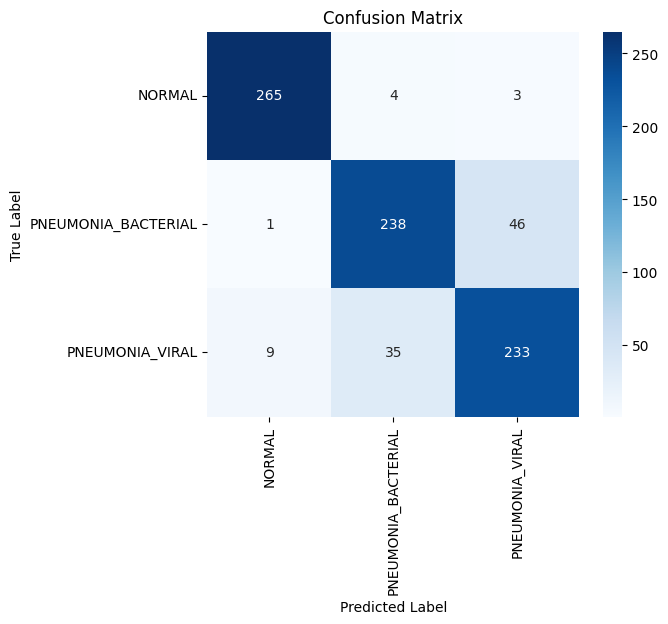
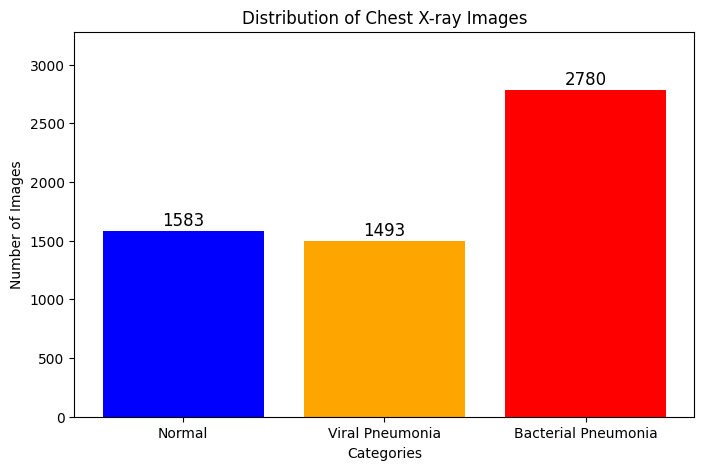
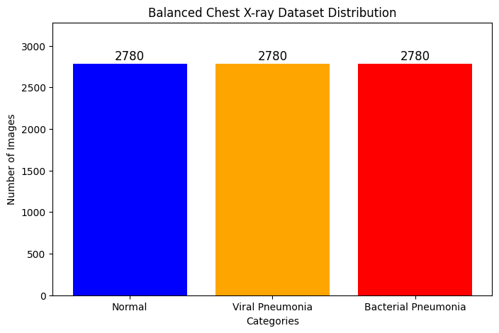
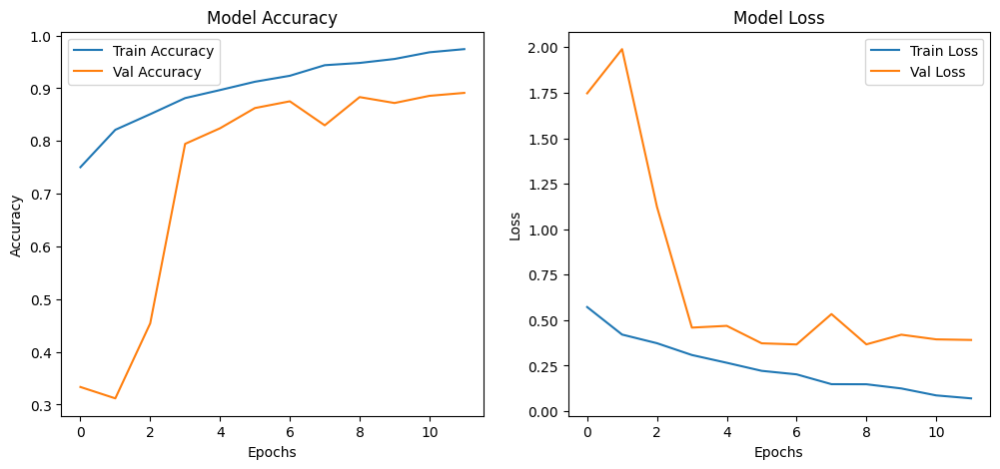
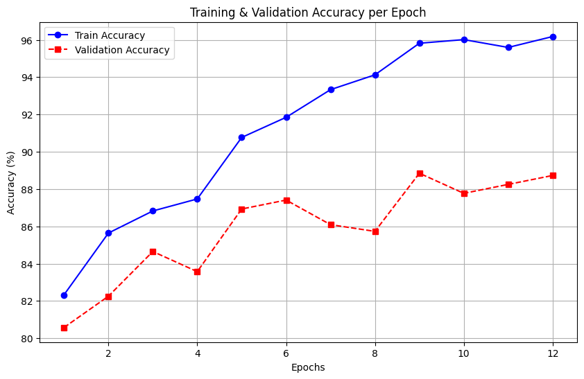
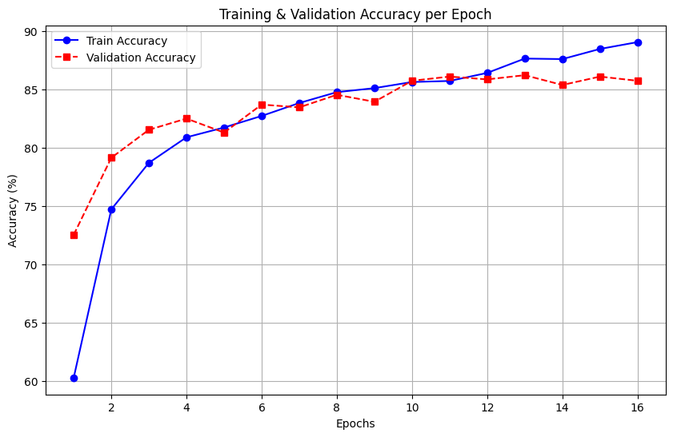
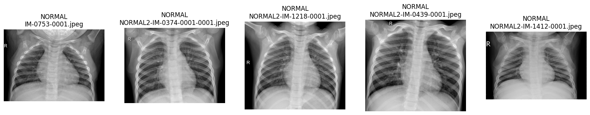
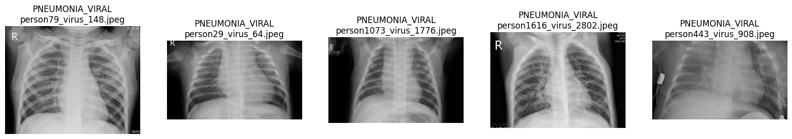
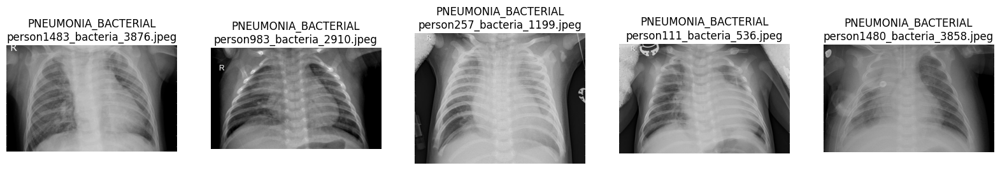

# Chest X-ray Pneumonia Classification with Deep Learning

Classifying chest X-ray images into **Normal**, **Bacterial Pneumonia** and **Viral Pneumonia** using transfer learning. Four pretrained architectures — **EfficientNet-B5**, **Vision Transformer (ViT-B/16)**, **ResNet-50** and **Xception** — were fine-tuned and compared on the same balanced dataset.


---

## Results

| Model | Framework | Test accuracy | Epochs (early stopping) |
|---|---|---|---|
| **Vision Transformer (ViT-B/16)** | PyTorch / torchvision | **87.65%** | 12 |
| EfficientNet-B5 | TensorFlow / Keras | 87.08% | 12 |
| Xception | PyTorch / timm | 87.05% | 14 |
| ResNet-50 | PyTorch / torchvision | 85.13% | 16 |

**Per-class results (Xception, test set of 834 images):**

| Class | Precision | Recall | F1-score |
|---|---|---|---|
| Normal | 0.96 | 0.97 | 0.97 |
| Bacterial Pneumonia | 0.86 | 0.84 | 0.85 |
| Viral Pneumonia | 0.83 | 0.84 | 0.83 |

**Key finding:** separating *Normal* from *Pneumonia* is easy for every model (~97% F1). The hard part is telling **bacterial and viral pneumonia apart** — almost all errors sit between those two classes, which matches how difficult that distinction is for radiologists from an X-ray alone.

<p align="center">
  
</p>

---

## Dataset

[Chest X-Ray Images (Pneumonia)](https://www.kaggle.com/datasets/paultimothymooney/chest-xray-pneumonia) — 5,856 paediatric chest X-ray JPEGs (Kermany et al., 2018), originally labelled **Normal** vs **Pneumonia**.

### From 2 classes to 3
The original *Pneumonia* folder was split into **bacterial** and **viral** using the labels embedded in each file name (`..._bacteria_...`, `..._virus_...`), turning the task into a 3-class problem:

| Class | Images |
|---|---|
| Bacterial Pneumonia | 2,780 |
| Normal | 1,583 |
| Viral Pneumonia | 1,493 |

### Handling class imbalance
The minority classes (Normal, Viral) were oversampled with **Albumentations** (horizontal flip, ±20° rotation, brightness/contrast, Gaussian blur, random resized crop) until every class had **2,780 images** — 8,340 in total.

| Before | After |
|---|---|
|  |  |

The balanced set was split **70 / 15 / 15** into train / validation / test for the Keras model, and **80 / 10 / 10** for the PyTorch models.

---

## Approach

```
Raw X-rays ─► split Pneumonia into Bacterial / Viral ─► augment minority classes to 2,780 each
          ─► train / val / test split ─► fine-tune pretrained CNN / ViT ─► evaluate & compare
```

| | EfficientNet-B5 | ViT-B/16 | ResNet-50 | Xception |
|---|---|---|---|---|
| Pretrained on | ImageNet | ImageNet | ImageNet | ImageNet |
| Head | GAP → Dense(512, ReLU) → Dropout(0.3) → Dense(3) | Linear(768→3) | Linear(2048→3) | Linear(2048→3) |
| Optimiser | Adam, lr 1e-4 | AdamW, lr 5e-5, wd 5e-3 | AdamW, lr 1e-5, wd 1e-3 | AdamW, lr 5e-5, wd 5e-3 |
| LR schedule | ReduceLROnPlateau | Cosine annealing | ReduceLROnPlateau | Cosine annealing |
| Early stopping | val loss, patience 5 | val acc, patience 3 | val acc, patience 3 | val acc, patience 3 |

All models use 224×224 inputs, batch size 32, and on-the-fly augmentation during training (rotation, shifts, zoom, flips / colour jitter).

### Training curves

| EfficientNet-B5 | ViT-B/16 | ResNet-50 |
|---|---|---|
|  |  |  |

### Sample images

| Normal | Viral pneumonia | Bacterial pneumonia |
|---|---|---|
|  |  |  |

---

## Repository structure

```
.
├── notebooks/
│   └── chest_xray_classification.ipynb   # full pipeline: data prep, augmentation, 4 models, evaluation
├── images/                               # figures exported from the notebook
├── requirements.txt
└── README.md
```

## How to run

1. Download the dataset from Kaggle and place the `NORMAL` and `PNEUMONIA` folders under one input folder.
2. Open `notebooks/chest_xray_classification.ipynb` on **Kaggle** or **Google Colab** with a GPU enabled (the notebook was run on Kaggle; paths use `/kaggle/input/...` and `/kaggle/working/...` — update them if you run elsewhere).
3. Install dependencies if needed: `pip install -r requirements.txt`
4. Run all cells top to bottom.

## Limitations and next steps

- **Possible data leakage:** augmented copies were created *before* the train/val/test split, so variants of the same original X-ray can appear in both training and test sets. Reported accuracy is therefore likely optimistic. Next step: split first, augment only the training set, and keep the test set to original images.
- In the PyTorch runs, `random_split` shares the training transforms with the validation/test subsets; separate eval transforms would give a cleaner measurement.
- Bacterial vs viral confusion is the main error source — class-weighted loss, higher input resolution or Grad-CAM inspection could help.
- Add AUC/ROC, Grad-CAM explainability, and a simple Streamlit/Gradio demo.

> ⚠️ This is an educational project and is **not** a medical diagnostic tool.

## Tech stack

Python · TensorFlow / Keras · PyTorch · torchvision · timm · Albumentations · OpenCV · scikit-learn · NumPy · pandas · Matplotlib · Seaborn · Kaggle GPU · Google Colab

## Author

**Deepanshu** — feel free to connect on LinkedIn or open an issue with questions.
